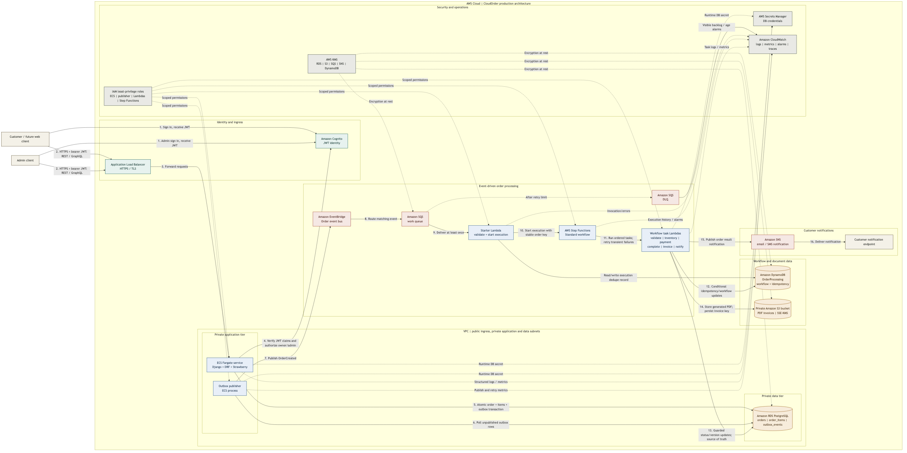
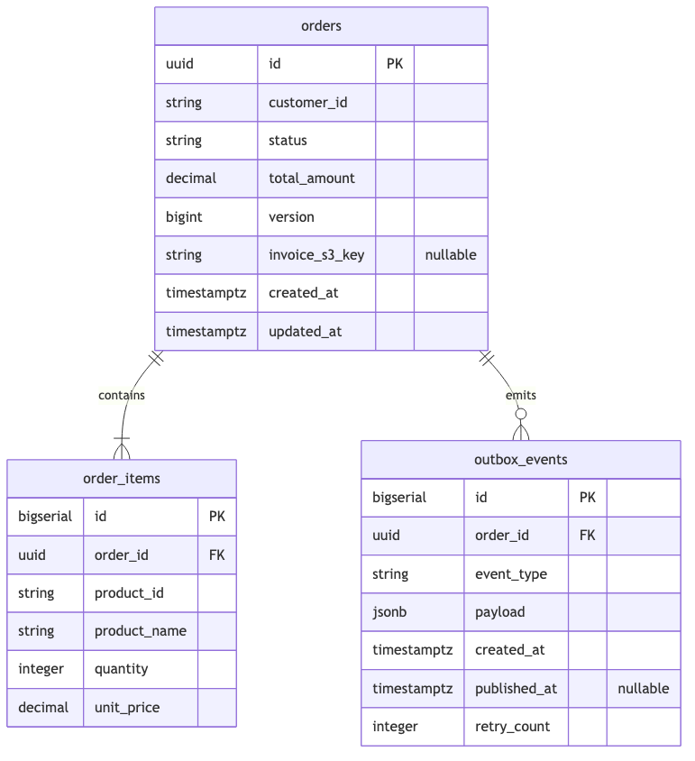
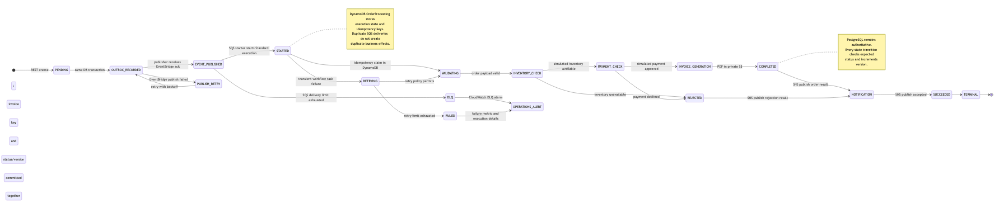

Customer access requires the Cognito `Customer` group; admin access is determined from the `Admin` group claim. Self-sign-up is disabled so every protected account is explicitly assigned to one of these groups. Assign Admin membership only to operators.
# CloudOrder

CloudOrder is a backend-only, event-driven order management service built with Django, Django REST Framework, Strawberry GraphQL, PostgreSQL, DynamoDB, and AWS CDK. It accepts orders synchronously, records an outbox event in the same PostgreSQL transaction, and processes accepted orders asynchronously through EventBridge, SQS, Lambda, and a Standard Step Functions workflow.

No AWS deployment has been run. CDK synthesis and template tests are local; creating or deploying AWS resources requires your explicit approval.

## Architecture



The main diagram has editable Mermaid source at [cloudorder-architecture.mmd](docs/architecture/cloudorder-architecture.mmd) and a vector version at [cloudorder-architecture.svg](docs/architecture/cloudorder-architecture.svg). The database schema and order lifecycle are separately documented in [database-erd.mmd](docs/architecture/database-erd.mmd) and [order-workflow.mmd](docs/architecture/order-workflow.mmd).

### AWS services

| Service | Responsibility |
| --- | --- |
| Amazon VPC | Public ALB subnets, private application subnets, isolated database subnets |
| Amazon Cognito | Customer identity, access tokens, and Admin group |
| Application Load Balancer | HTTPS termination and HTTP-to-HTTPS redirect |
| Amazon ECS Fargate | Django API and independent outbox publisher services |
| Amazon ECR | CDK Docker image assets for the Fargate and Lambda containers |
| Amazon RDS for PostgreSQL | Authoritative order state, order lines, and transactional outbox |
| Amazon DynamoDB | `OrderProcessing` workflow execution and idempotency metadata |
| Amazon EventBridge | Routes `OrderCreated.v1` events to the processing queue |
| Amazon SQS and SQS DLQ | Durable at-least-once delivery, retries, and poison-message isolation |
| AWS Lambda | SQS starter and Step Functions task handlers |
| AWS Step Functions Standard | Durable order validation, simulated checks, completion, invoice, and notification orchestration |
| Amazon S3 | Private PDF invoice storage with short-lived presigned downloads |
| Amazon SNS | Order outcome notifications and CloudWatch alarm delivery |
| AWS Secrets Manager | RDS credentials and Django signing secret |
| AWS KMS | AWS-managed KMS encryption for RDS, DynamoDB, S3, SNS, and SQS |
| Amazon CloudWatch | Container/Lambda/workflow logs, metrics, and DLQ/workflow alarms |

The Fargate and workflow Lambda tasks connect to RDS from private subnets. The database security group accepts PostgreSQL only from those task security groups. NAT gateways provide egress for private tasks; this improves service reachability but is a material recurring cost.

### Database ER diagram



The application owns exactly three relational models: `orders`, `order_items`, and `outbox_events`. There are no Django auth, session, or content-type tables. Django's migration recorder is framework metadata created by the standard migration command; it is not an application/domain table.

```text
orders
  id UUID primary key
  customer_id, status, total_amount, version, invoice_s3_key
  created_at, updated_at

order_items
  id, order_id foreign key, product_id, product_name
  quantity, unit_price

outbox_events
  id, order_id foreign key, event_type, payload
  created_at, published_at, retry_count
```

PostgreSQL remains authoritative for order state. DynamoDB is operational metadata and does not replace the order tables.

### Order workflow



Order creation and outbox insertion commit atomically. The publisher marks an outbox event published only after EventBridge accepts it. SQS and Step Functions are at-least-once, so the starter uses a stable execution name and a conditional DynamoDB record. State changes lock the PostgreSQL order row, validate the expected state, and increment `version`. The invoice is written under a deterministic S3 key before the database commits `COMPLETED` and that key together.

## API

All customer endpoints require a Cognito **access token** in `Authorization: Bearer <token>`. JWT validation checks the RS256 signature against the user-pool JWKS, issuer, expiration, `token_use=access`, client ID, and subject. Customers can access only their own orders. Cognito users in the `Admin` group can read all orders and bypass ownership checks.

### REST

REST is used for resource-oriented commands and operational endpoints: create and cancel have conventional HTTP status codes; invoice retrieval can return a short-lived URL after an authorization check; health is a simple load-balancer probe. Order list/detail REST reads are also provided for straightforward integrations.

```http
GET /health/
GET /api/v1/orders/?limit=20&cursor=<opaque-cursor>
POST /api/v1/orders/
GET /api/v1/orders/{id}/
POST /api/v1/orders/{id}/cancel/
GET /api/v1/orders/{id}/invoice/
```

Create an order:

```bash
curl -X POST "$BASE_URL/api/v1/orders/" \
  -H "Authorization: Bearer $COGNITO_ACCESS_TOKEN" \
  -H 'Content-Type: application/json' \
  -d '{"items":[{"product_id":"sku-100","product_name":"Desk lamp","quantity":2,"unit_price":"12.50"}]}'
```

The API returns `201 Created` with an order in `PENDING`. Cancellation is allowed only from `PENDING`; invalid transitions return `409 Conflict`. Invoice retrieval returns `409` until a completed order has a stored invoice key. A valid invoice response contains a presigned URL that expires after 300 seconds.

### GraphQL

GraphQL is used for read-oriented order queries where clients benefit from selecting nested fields and cursor pagination. It shares the same application service and authorization rules as REST.

```graphql
query Order($id: ID!) {
  order(id: $id) {
    id
    status
    totalAmount
    version
    items { productId productName quantity unitPrice }
  }
}
```

```graphql
query MyOrders($limit: Int, $cursor: String) {
  myOrders(limit: $limit, cursor: $cursor) {
    nodes { id status totalAmount createdAt }
    nextCursor
  }
}
```

```graphql
query AllOrders($limit: Int, $cursor: String) {
  allOrders(limit: $limit, cursor: $cursor) {
    nodes { id customerId status totalAmount }
    nextCursor
  }
}
```

`allOrders` is admin-only. Limits are 1 through 100. Cursors are signed and expire after one day.

## Local development

Prerequisites: Docker Desktop with Compose, Python 3.12 or newer, and Node.js 22 or 24 for the CDK CLI.

```bash
docker compose up --build
```

Compose starts PostgreSQL, LocalStack, Django, and the outbox publisher. The LocalStack init script creates the local DynamoDB table, private invoice bucket, SNS topic, EventBridge bus, SQS queue/DLQ, and EventBridge route. Local endpoints are `http://localhost:8000` for Django and `http://localhost:4566` for LocalStack. The API container runs Django migrations at startup. Check `GET http://localhost:8000/health/` for the process health response.

The Compose credentials and Django key are disposable **local-only** values. Never reuse them in AWS. LocalStack verifies PostgreSQL plus outbox-to-EventBridge/SQS wiring; Lambda and Step Functions are tested through handler tests and synthesized CDK definitions, not by starting a cloud workflow locally. Authenticated API tests use signed-token verification tests and mocked Cognito claims. To exercise a live protected API, use a Cognito access token from an explicitly approved AWS deployment.

Useful commands:

```bash
docker compose ps
docker compose logs -f api outbox localstack
docker compose down
```

`docker compose down -v` deletes the local Postgres and LocalStack data volumes.

To run tests outside Docker:

```bash
python3 -m venv .venv
source .venv/bin/activate
python -m pip install -r requirements.txt -r infra/cloudorder_cdk/requirements.txt
python -m pytest -q
python manage.py check
```

Pytest uses in-memory SQLite, so the test suite does not require PostgreSQL or AWS. Production uses PostgreSQL through Django's ORM.

## Postman

Import [CloudOrder.postman_collection.json](postman/CloudOrder.postman_collection.json) into Postman. Set collection variables:

- `baseUrl`: `http://localhost:8000` for health or the approved HTTPS API hostname for authenticated requests.
- `accessToken`: a Cognito access token, not an ID token.
- `orderId`: populated by the Create order request's test script.
- `cursor`: optional cursor returned from an order list response.

The collection includes health, order create/list/detail/cancel/invoice, and customer/admin GraphQL requests. Local Compose does not issue Cognito tokens.

## AWS CDK

The CDK app is in [infra/cloudorder_cdk/app.py](infra/cloudorder_cdk/app.py). `CloudOrderFoundation` provisions the VPC, RDS, DynamoDB, S3, Cognito, event bus, queues, and SNS. `CloudOrderRuntime` provisions Fargate/ECR image assets, the TLS ALB, Lambda handlers, the Standard state machine, IAM permissions, and alarms.

Synthesis is safe and does not create AWS resources:

```bash
source .venv/bin/activate
python -m pip install -r requirements.txt -r infra/cloudorder_cdk/requirements.txt
npm install --global aws-cdk
cd infra/cloudorder_cdk
cdk synth
```

To deploy later, first obtain explicit approval because bootstrap/deploy creates chargeable AWS resources. Then configure AWS credentials, select the target account/region, ensure an ACM certificate exists for the API hostname, and bootstrap that environment. The required runtime parameters are `AlbCertificateArn` and `ApiHostName`; the hostname must be covered by the certificate and have DNS pointing to the ALB.

Example commands for an approved deployment only:

```bash
cdk bootstrap aws://ACCOUNT_ID/REGION
cdk deploy CloudOrderFoundation
cdk deploy CloudOrderRuntime \
  --parameters CloudOrderRuntime:AlbCertificateArn=arn:aws:acm:REGION:ACCOUNT_ID:certificate/CERTIFICATE_ID \
  --parameters CloudOrderRuntime:ApiHostName=api.example.com
```

After infrastructure is approved and deployed, run `python manage.py migrate --noinput` once in a one-off ECS task using the API task definition, private application subnets, and API security group before routing customer traffic. Do not run migrations independently in each API replica. Then create/assign Cognito users to the appropriate groups, subscribe an approved notification endpoint to the SNS topic, and configure DNS for the ALB.

The image assets are published to ECR by CDK. CDK bootstrap resources, NAT gateways, ALB, minimum Fargate capacity, and Multi-AZ RDS all have ongoing costs. No pricing estimate is asserted here because it depends on region, traffic, storage, and retention; use the AWS Pricing Calculator for the chosen region and load profile before approval.

## Security architecture

- Cognito access-token signature, issuer, expiration, token-use, client ID, and subject are validated before the API trusts a principal.
- Customer ownership is checked in the shared application service; GraphQL and REST do not implement separate authorization rules.
- Admin access is determined from the Cognito `Admin` group claim. The CDK creates `Customer` and `Admin` groups; assign Admin membership only to operators.
- RDS is encrypted, Multi-AZ, private, and reachable only on PostgreSQL port 5432 from the API, publisher, and workflow task groups.
- Public traffic reaches the application only through the HTTPS ALB; port 80 redirects to HTTPS. The ECS tasks and RDS have no public IPs.
- RDS credentials and Django signing key are generated/stored in Secrets Manager and injected or read at runtime. No AWS credentials are embedded in application code.
- S3 blocks public access and requires TLS. Invoice downloads use short-lived presigned URLs after ownership/admin checks.
- SQS, SNS, DynamoDB, RDS, and S3 use AWS-managed KMS encryption at rest. IAM grants are scoped to the required table, bucket, event bus, queue, topic, secret, and state machine operations.
- CDK retains stateful data resources by default; review retention and deletion protection before any approved teardown.

## Retries and failure handling

- Outbox rows remain unpublished when EventBridge rejects a publish; `retry_count` increments and the ECS publisher retries on its polling interval. EventBridge target delivery retries up to 10 attempts and sends undeliverable events to the SQS DLQ.
- SQS visibility timeout is 3 minutes, with a redrive limit of five receives. The starter returns partial batch failures so one bad record does not replay successful records in the same batch.
- A stable Step Functions execution name and conditional DynamoDB item protect against duplicate SQS deliveries. DynamoDB also records the execution ARN and last workflow action/result.
- Step Functions retries transient Lambda throttling/service/timeouts with backoff. Terminal processing exceptions mark an in-progress PostgreSQL order `FAILED`; inventory/payment declines transition to `REJECTED` and publish an SNS outcome.
- The workflow writes invoice bytes to a deterministic S3 key, then performs a guarded PostgreSQL transition to `COMPLETED` with the invoice key. Repeated task attempts can recognize an already completed order.
- Customer SNS delivery is at-least-once. A downstream notification consumer should treat `order_id` as its idempotency key.
- CloudWatch alarms cover DLQ depth, failed Standard executions, and starter Lambda errors. Investigate execution history and DLQ message bodies before redriving.

## Scalability and performance

- API tasks scale on CPU and sit behind an ALB. Increase task limits/CPU based on measured latency and saturation rather than request volume alone.
- RDS uses Multi-AZ for availability; connection reuse is configured in Django. For high concurrency, add a connection pool such as RDS Proxy after measuring database connection pressure.
- Outbox publishing is a separate single Fargate service so API latency does not depend on EventBridge. Increase publisher throughput carefully; row locking and consumer idempotency allow safe parallelism.
- SQS buffers bursts and decouples request handling from workflow latency. Standard Step Functions supports long-running durable execution with per-task retries.
- DynamoDB uses on-demand capacity; S3 stores invoices outside the relational database. Cursor pagination bounds database work and result size.
- `allOrders` is admin-only and paginated; avoid unbounded exports through API resolvers.

## AWS cost considerations

- Two NAT gateways are a major baseline cost; they provide AZ-aligned private egress. A reviewed lower-cost non-production design can use one NAT gateway, accepting reduced AZ independence, or carefully designed VPC endpoints.
- Multi-AZ RDS and two minimum Fargate API tasks prioritize availability but cost more than single-AZ/one-task development tiers.
- The ALB, public IPv4 addresses, NAT data processing, CloudWatch log ingestion/retention, KMS requests, and provisioned snapshots/backups add costs beyond compute.
- Fargate, Lambda invocations, Standard Step Functions state transitions, SQS requests, EventBridge events, DynamoDB on-demand reads/writes, SNS delivery, and S3 storage scale with usage.
- Configure log retention and invoice lifecycle based on business/legal requirements. Do not shorten backup or invoice retention without an approved retention policy.
- Estimate with the AWS Pricing Calculator for a specific region and expected order rate. Review AWS Budgets and billing alarms before deployment.

## Design patterns and SOLID

- **Single responsibility**: API serializers/views handle transport; `OrderApplicationService` owns use cases; `DjangoOrderRepository` owns PostgreSQL persistence; AWS adapters own EventBridge/S3 concerns.
- **Dependency inversion**: the application service depends on `OrderRepository` protocol, and the Django adapter implements it. API and GraphQL are thin transports over the same service.
- **Open/closed**: repository and invoice-storage boundaries allow alternate adapters for tests or other infrastructure without changing order rules.
- **Safe state transitions**: the domain transition map defines allowed lifecycle changes; the repository applies them under a row lock and increments a version.
- **Transactional outbox**: the order and event are committed together, avoiding a dual-write gap between PostgreSQL and EventBridge.
- **Idempotent consumer**: stable workflow names and DynamoDB conditional writes make at-least-once SQS delivery safe to start.
- **Dependency injection**: API service construction is centralized in `get_order_service`; tests can replace verifier/repository/AWS clients at their boundaries.

## Verification

```bash
python -m pytest -q
python manage.py check
cd infra/cloudorder_cdk && python app.py
```

The tests cover REST/GraphQL behavior, customer/admin authorization, signed JWT validation, transactional outbox creation, retries, duplicate SQS delivery, state transitions, simulated inventory/payment, PDF generation, and CDK synthesized resources. CDK synthesis verifies infrastructure templates only; no AWS integration or deployment was performed.